<p align="center">
  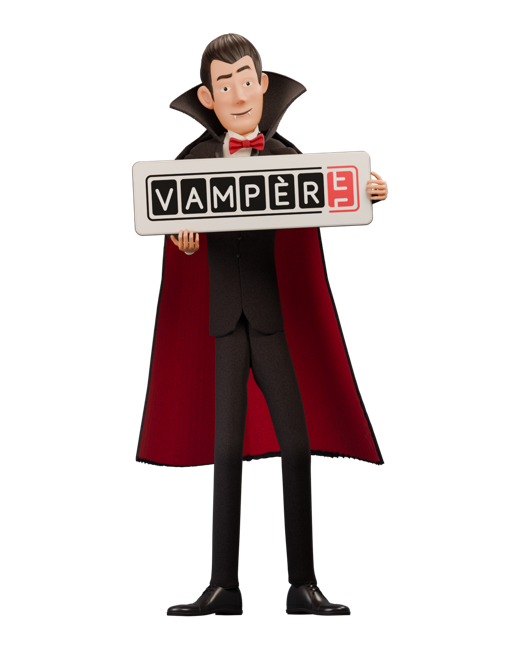
</p>

<h1 align="center">Vampère</h1>

<p align="center"><b>We hunt the energy vampires. You decide which ones may go.</b></p>

<p align="center">
  GreenOps for SMEs · built at sprintd Basel 2026 for the «Green AI & Data» case (Basel 2037)
</p>

---

Every small company has **energy vampires**: not the blood kind, but servers that run all night, licences nobody opens and AI models far too big for the job. Nobody sees them, because the bills are spread over dozens of exports, three currencies and several providers.

**Vampère** reads those exports and turns them into a 3D twin of your office. Every department is a room and every digital tool is an object you can click. It shows where your money, electricity and CO₂ go, finds the waste, and puts together a package of measures that meets your climate target and stays within budget. It never switches off something that must stay on.

> From weeks of data work to one picture in minutes.

---

## What it does in four steps

### 0 · Start from your floor plan

Upload a floor plan and Vampère reads it: the walls, the rooms and the desks. Then it builds a 3D model of the office. In the background it cleans up the company's data: **28 files and about 224,000 rows**. It removes duplicates and drafts, converts EUR and USD into francs, fills missing days, and **flags contradictions between sources instead of hiding them**.

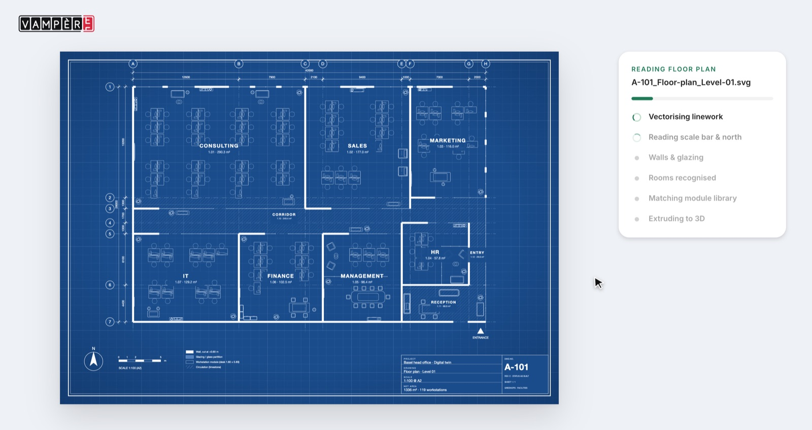

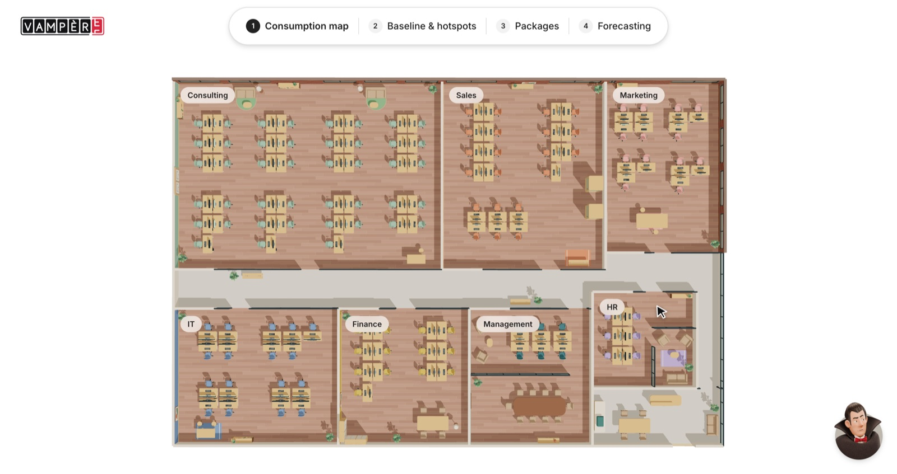

### 1 · Consumption map: see everything in one picture

Cloud, servers, AI and SaaS licences, all in one place and split by department. Open a room and you see the data centres it really uses behind it, drawn as floating islands (Zurich, Frankfurt, Dublin), each one with its own power grid.

Click any object to see its yearly cost, energy and CO₂, how many hours it **runs** compared with how many it actually **works**, and *how the number was calculated*.

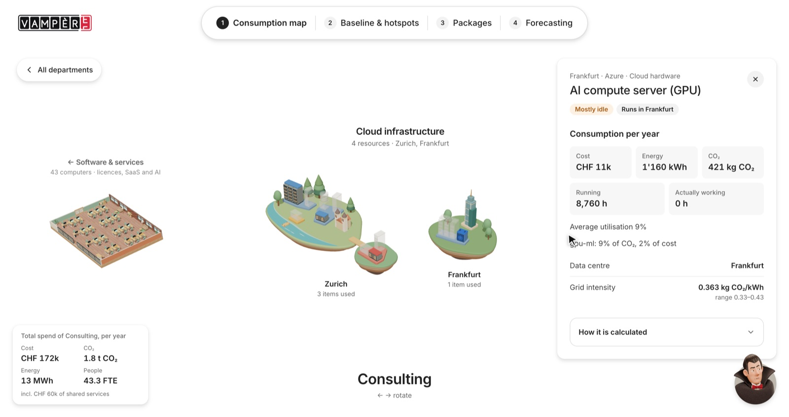

*An AI GPU server in Frankfurt: on for 8,760 hours a year, actually working for 0.*

### 2 · Baseline & hotspots: find the vampires

This step shows the baseline year: **CHF 475k, 25 MWh and 4.5 t CO₂** (location-based). Every room gets a badge with the number of problems found. Press play and you **watch the CO₂ clouds grow month by month** over each data centre.

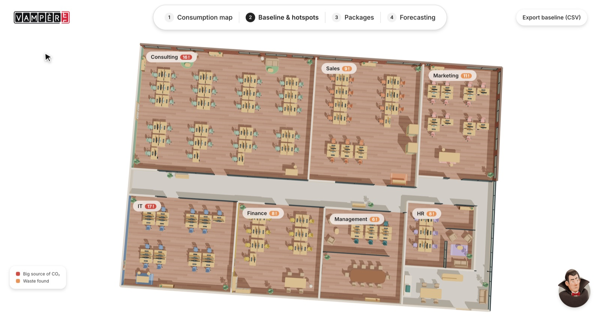

Each finding comes with its evidence. The biggest vampire hides in IT: the development data platform runs **24 hours a day and is idle 91 % of the time**, on a German grid about three times dirtier than Zurich's. Vampère's clustering puts it in a group with the other forgotten servers: *always on, almost never working.*

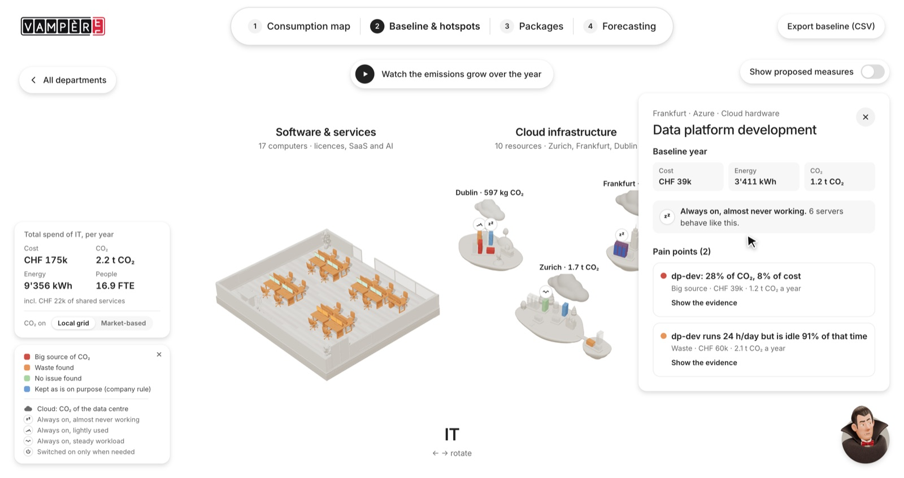

**Not every vampire may be killed.** A disaster-recovery server looks just as idle, but a management rule says it must stay on. Vampère keeps it, colours it blue and says why.

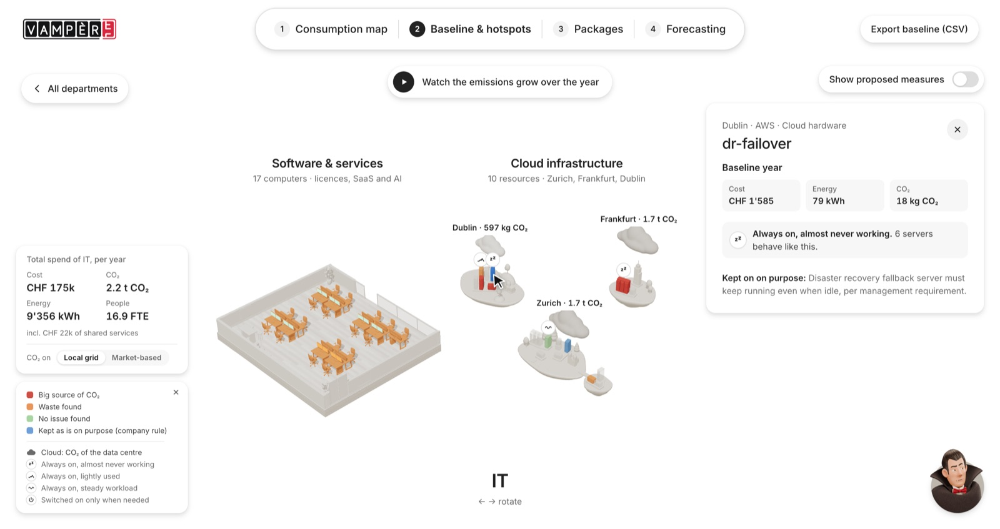

### 3 · Packages: decide

An optimiser builds the best package of measures for each goal. Every package meets the case rules: **−40 % CO₂, −25 % cost, at most CHF 16,500**.

| Strategy | What it optimises |
|---|---|
| **Climate first** | the largest CO₂ cut within the budget |
| **Best value** | the most CO₂ saved per franc spent |
| **Francs first** | the largest savings in francs |

For every package you see the effort in person-days, the savings in CHF, kWh and CO₂, and **how safe it is**: the share of 10,000 simulated scenarios (Monte Carlo) in which it still reaches the target.

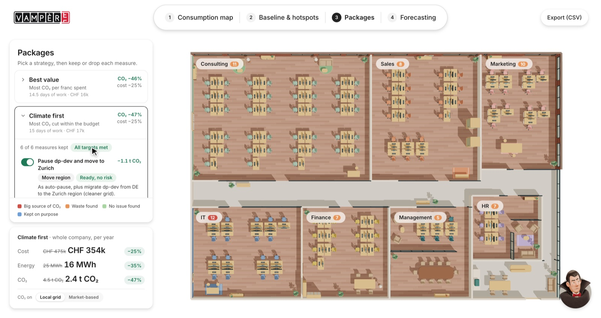

*Climate first: 6 measures, 15 person-days, CHF 16.5k. CO₂ −47 %, cost −25 %, targets met in 92 % of scenarios.*

Some measures need a human decision, for example because of a protection window, a critical system or a step that can't be undone. Vampère names **who has to say yes** (for example the Head of Consulting). If the answer is no, switch the measure off: the 3D scene turns red where the vampire stays and every total is recalculated live.

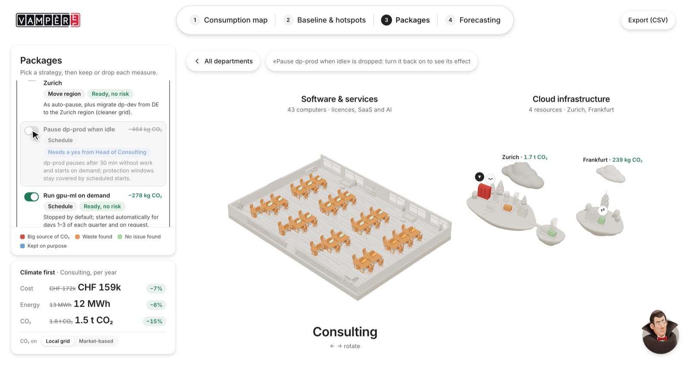

#### Beyond the package

Two ideas that sit outside the budget, each with its own report:

- **Carbon-aware scheduling.** Move flexible jobs to the cleaner hours of the day. Vampère shows the hourly grid curves for each region and an honest result: about **−12 kg CO₂ a year**, compared with −921 kg for simply moving one server to Zurich. *Where and whether matter more than when.*

  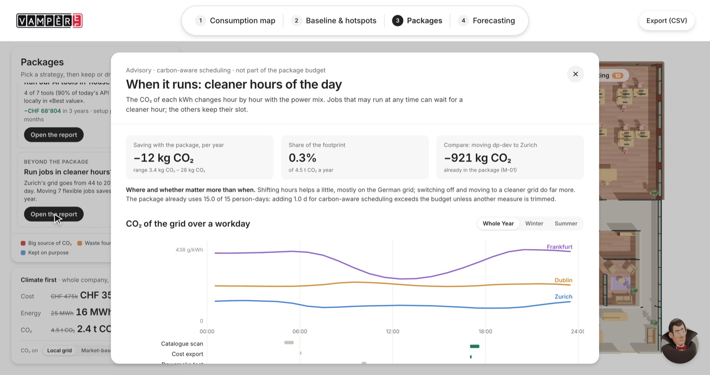

- **Running AI in-house.** Move 4 of the 7 AI tools onto a GPU server the company already has. That saves **CHF 68,804 over 3 years**, pays back after **17 months**, and keeps private business data in-house.

  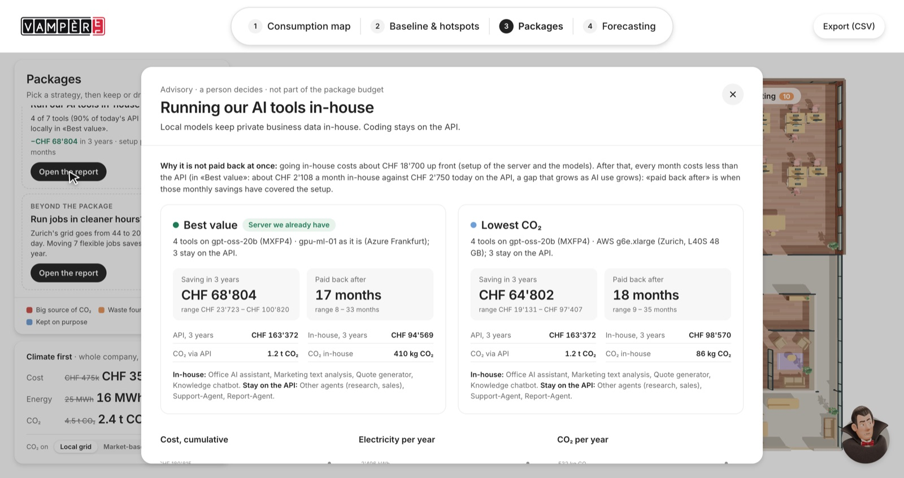

#### Market-based view

With one switch, CO₂ is counted market-based (by electricity certificates) instead of by the local grid. The same electricity then counts as **7 t instead of 4.5 t**, because the company buys no certificates. Vampère shows this view next to the location-based one but keeps the targets location-based: *buying certificates doesn't make the grid cleaner.*

### 4 · Forecasting: look ahead

Next year side by side, **without changes** and **with the chosen package**. The 12 months play by themselves, and you can open the charts with ranges. Without changes, costs rise to **CHF 522k**. With *Climate first* the company saves **CHF 125k and 2.1 t CO₂**.

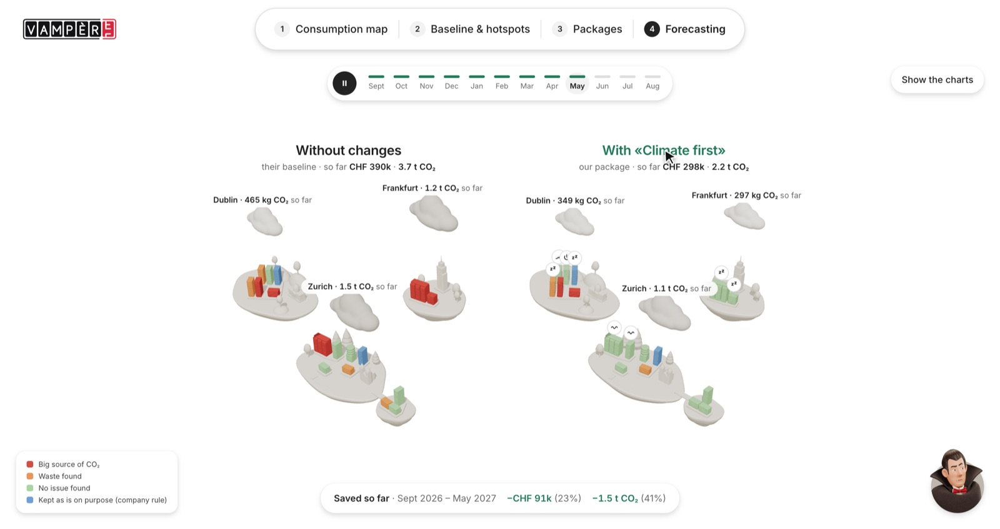

---

## Meet Wattson, the vampire hunter

<p>
  
  
  
  
  
  
</p>

Wattson lives in the corner of every screen. Ask him anything about costs, CO₂ or a measure, for example *«Can we switch off dp-prod at night?»*. He answers in plain language, names the person who has to decide, and **every number he gives is checked by code** before you see it. If a ticket in the data contains a hidden instruction aimed at the AI, he ignores it and tells you so.

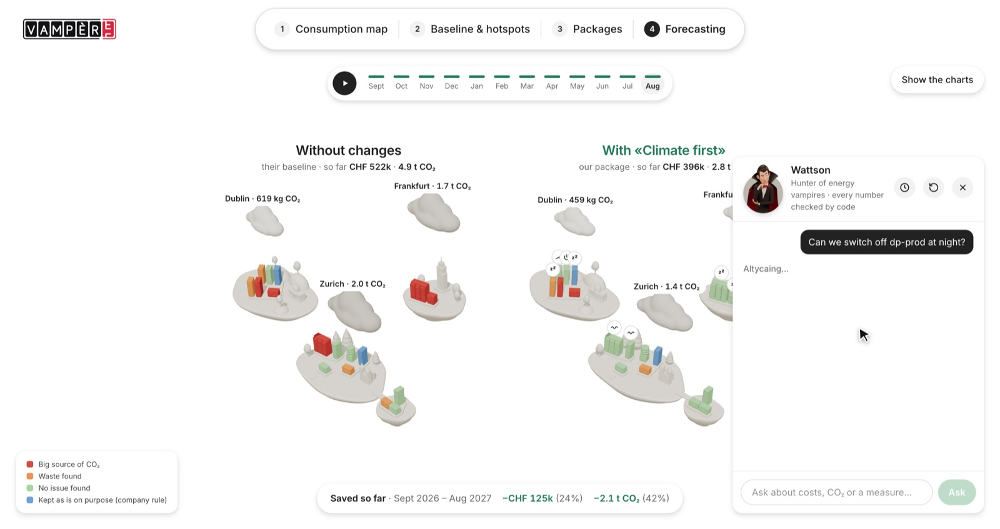

The character was modelled and animated in Blender. He waves, searches, thinks, talks, gets scared and hides behind his cape, depending on what is happening in the app.

---

## Why you can trust the numbers

- **Every figure is calculated by code from the data**, never made up by the AI. Every number has an open calculation, a source and a range.
- **Same data, same answer.** The AI only runs again when the input data changes; otherwise the saved results are reused.
- **Protected by design.** Rules in the data can only make a measure *stricter*, never unlock something. Protection windows, critical systems and protected resources are always respected.
- **Contradictions are flagged, not hidden.** When sources disagree, or the data can't answer the question, a person decides.
- **Location-based CO₂** with researched grid factors for Zurich, Frankfurt and Dublin, each with its source and range.
- **Exports** for the baseline and the packages as CSV, plus the filled submission tables.

## Our own AI footprint

We count our own energy too. One fresh analysis (8 AI calls) uses about **3 Wh and 0.6 g CO₂**. The app reports this next to the results, using the same factors as for the company's own AI use.

---

## Run it

```bash
git clone --recurse-submodules https://github.com/M4tteoo/vampere.git
cd vampere/web && npm install && npm run dev      # the app, on http://localhost:5173
python -m assistant serve                         # Wattson (optional), in a second terminal
```

To regenerate the analysis from the raw exports, see the **[technical reference](docs/technical.md)**, which covers the pipeline, the AI advisor, the safety rules, the outputs and the tests.

<p align="center"><sub>Data: «Sample data ALTYCA, sprintd Basel 2026». All usage data is synthetic and describes a fictitious company.</sub></p>
